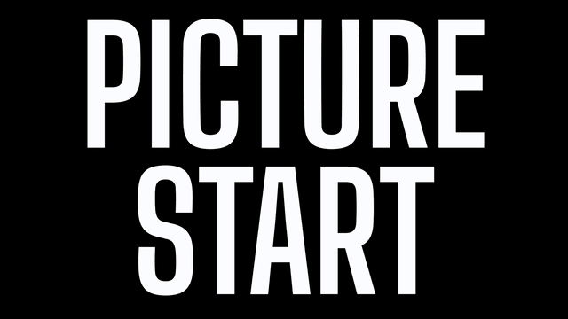
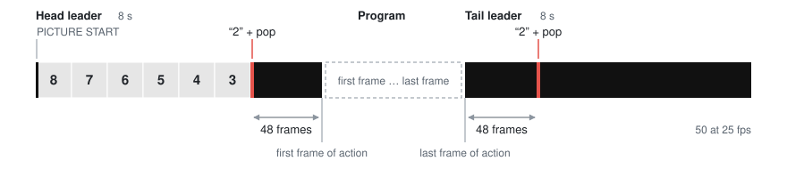

# countdown-leader

[](https://github.com/skeca/countdown-leader/actions/workflows/test.yml) [](https://github.com/skeca/countdown-leader/releases/latest) [](LICENSE)



Countdown leaders for the start and end of an edit, with a one-frame 2-pop to check sync. The files are ProRes 422 HQ with BT.709 color and 48 kHz / 24-bit stereo audio. They come in HD, UHD and DCI sizes at 23.976, 24 and 25 fps.

## Download

You can download individual files or a zip containing all 90 from the [releases page](https://github.com/skeca/countdown-leader/releases/latest). Checksums are included with each release.

There are three styles:

- **smpte** starts with PICTURE START, counts down from 8 to 3 with a sweep, then shows “2” for one frame with the pop.
- **simple** is black except for the single “2” frame and its pop.
- **tail** goes at the end of the edit, with the pop 2 seconds after the last frame.

Filenames follow the pattern `{style}_{raster}_{rate}.mov`, for example `smpte_uhd-scope_2397.mov`. The rate tags are `2397`, `24` and `25`.

| Raster | Size | Picture |
|---|---|---|
| `hd`, `uhd` | 1920×1080, 3840×2160 | full frame |
| `hd-scope`, `uhd-scope` | 1920×1080, 3840×2160 | 2.39 letterbox (1920×804, 3840×1608) |
| `2k-full`, `4k-full` | 2048×1080, 4096×2160 | full DCI container |
| `2k-flat`, `4k-flat` | 1998×1080, 3996×2160 | DCI Flat, 1.85 |
| `2k-scope`, `4k-scope` | 2048×858, 4096×1716 | DCI Scope, 2.39 |

## How to use them

Choose a file that matches your timeline's frame rate. Place the head leader directly before the first frame of picture and the tail leader directly after the last frame. The head leader already includes the 2 seconds between the pop and picture, so you don't need to add any black or leave a gap.



The pop is a one-frame, 1 kHz tone at −20 dBFS on both channels. It falls 48 frames before picture at 24 and 23.976 fps, or 50 frames before picture at 25 fps. At 23.976 fps, those 48 frames take 2.002 seconds. You can generate a version at −18 dBFS with `--pop-dbfs -18`.

## How to build your own

You need Python 3.11+ and FFmpeg 6+ (with `prores_ks`).

```sh
python3 -m venv .venv && .venv/bin/pip install -r requirements.txt
.venv/bin/python generate.py --style smpte --fps 24 --width 3840 --height 2160 \
  --active-aspect 2.39 --out my-leader.mov
```

To build all 90 files, run `make -j6`. Run `make test` to check the code.

To build a release zip, run `./package.sh 1.0.0`. The script also checks the files in the finished archive. [docs/spec.md](docs/spec.md) describes how the leaders are generated and what the checks cover.

## License

The code and documentation are licensed under [MIT](LICENSE). The Big Shoulders Display and Inter fonts are licensed separately under [SIL OFL 1.1](fonts/OFL.txt). You can use the leaders however you like, with no credit required.
