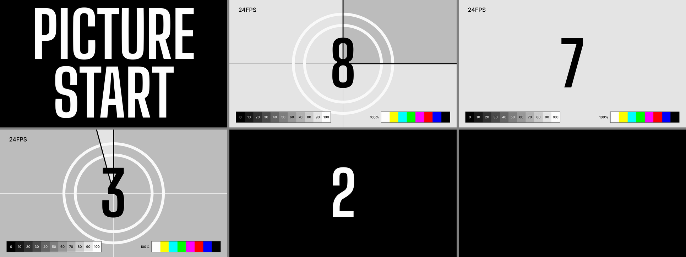
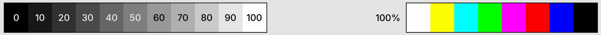

# How the leaders are made

## Timing

| Rate | Frames | Head pop | Tail pop | Length |
|---|---:|---:|---:|---:|
| 23.976 (24000/1001) | 192 | frame 144 | frame 48 | 8.008 s |
| 24 | 192 | frame 144 | frame 48 | 8 s |
| 25 | 200 | frame 150 | frame 50 | 8 s |

Frames count from zero. A head leader ends right where picture starts, so its pop is always 48 frames (50 at 25) before the first frame of action. The tail starts right after the last frame, and its pop is the same distance after it.

The `smpte` head at 24 fps, frame by frame:

| Frames | Picture |
|---|---|
| 0 | PICTURE START |
| 1–23 | “8” with the sweep |
| 24 | “7” alone, no dial |
| 25–47 | “7” with the sweep |
| 48–143 | 6, 5, 4, 3, same pattern |
| 144 | “2” with the pop |
| 145–191 | black |

At 25 fps each number gets 25 frames. The `simple` head and the `tail` are black except for the “2” frame.

At all three rates a frame is a whole number of samples (2002, 2000 and 1920), so picture and sound line up exactly. The pop begins on the first sample of its frame and ends inside it.

## Picture



The sweep turns clockwise once per second. The first frame of each number from 7 to 3 shows the digit alone. The frame rate is printed top left.



The swatches stay on screen through the countdown. On the left is grayscale from 0 to 100% of the video range, and on the right 100% RGB bars. They help you check that the signal arrives as BT.709 limited range.

The artwork is drawn in full-range RGB and converted to limited-range BT.709: luma 64–940 and chroma 64–960 in 10-bit. Every black frame is exactly Y 64, Cb/Cr 512, and so is the black around the “2”. ProRes encoding can push a few pixels at sharp edges slightly outside the nominal range (under 0.1% of a countdown frame).

The letterbox on `hd-scope` and `uhd-scope` is centred, the same height top and bottom (138 and 276 rows), and the artwork stays inside the picture area.

## Files

- **Video:** ProRes 422 HQ (`apch`), 10-bit 4:2:2, progressive, square pixels.
- **Colour:** BT.709 primaries, transfer and matrix, limited range. Tagged in the ProRes frame header and the MOV `colr` atom (`nclc` 1-1-1).
- **Audio:** 48 kHz, 24-bit PCM, stereo, identical left and right. The pop is the only sound: 1 kHz, one frame, −20 dBFS peak by default, with 2 ms fades so it doesn't click.
- **No timecode track:** source timecode starts at zero.

## Checks

Each generated file is decoded and checked for format, frame count, timestamps, audio length, pop timing and level, channel agreement, and expected picture and black frames. `verify_swatches.py` checks the bars and grayscale against the expected BT.709 values.

Release packaging repeats the media checks on the archived files and verifies their SHA-256 checksums.

## Custom renders

For example, to make an HD head leader at 25 fps with a −18 dBFS pop:

```sh
.venv/bin/python generate.py --style smpte --fps 25 \
  --width 1920 --height 1080 --pop-dbfs -18 --out my-leader.mov
```

Choose `smpte`, `simple` or `tail` for the style, and `23.976`, `24` or `25` for the frame rate. Add `--active-aspect 2.39` for a letterboxed picture.

Width and height must be even and at least 64 pixels. The pop level can be anything from −60 to 0 dBFS. Keep custom files out of `out/`, which holds only the release set.
